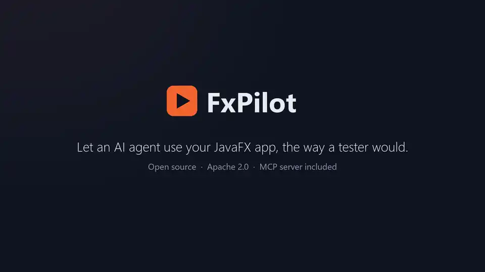

# FxPilot

[](https://github.com/dbuedenbender/fxpilot/actions/workflows/build.yml)
[](https://central.sonatype.com/artifact/io.github.dbuedenbender/fxpilot)
[](https://dbuedenbender.github.io/fxpilot/)

<a href="https://cdn.jsdelivr.net/gh/dbuedenbender/fxpilot@main/docs/media/fxpilot-demo.mp4"></a>

*Demo: the agent turns "Add the customer Acme Tools from Austria, wholesale, credit limit 20,000" into `fx_*` calls, fills the form, saves it and verifies the result. Looping 30-second preview — [full demo with setup, deny list and replay (1:15)](https://cdn.jsdelivr.net/gh/dbuedenbender/fxpilot@main/docs/media/fxpilot-demo.mp4).*

**Drive a running JavaFX app with plain-language requests.** No test code — and with the Java agent, no changes to the app at all.

FxPilot lets Claude Code read the scene graph, click, enter text, select items and take screenshots. It has two parts:

```
Claude Code ──stdio/MCP──> fxpilot.jar (MCP server) ──HTTP 127.0.0.1:<port>──> fxpilot.jar (inside the app)
```

- `fxpilot.jar` contains both sides: `java -jar fxpilot.jar` starts the MCP server, and `-javaagent:fxpilot.jar` (or a Maven dependency) starts the HTTP endpoint inside the app.

Requirements: JDK 11 or newer, JavaFX 11 or newer. The jar is compiled for Java 11 (`--release 11`); CI builds it on JDK 17, runs the tests on JDK 21 and starts the MCP server from the built jar on JDK 11; the endpoint inside a JavaFX app is not tested on a JDK 11 runtime. The app only needs `javafx-controls`; `javafx-web` and `javafx-swing` are optional. If JavaFX is missing or older than 11, the endpoint does not start and logs the reason to stderr. With `-javaagent`, the toolkit is usually not running yet when the agent starts, so only the presence of JavaFX is checked there.

> **Modular apps:** `fxpilot.jar` is the JPMS module `io.github.dbuedenbender.fxpilot`, which exports `io.github.dbuedenbender.fxpilot` (`FxPilotServer`, `FxPilotAgent`) and `io.github.dbuedenbender.fxpilot.mcp` (`FxPilotMcpServer`). A modular app puts the jar on the module path and adds `requires io.github.dbuedenbender.fxpilot;`; the module brings `jdk.httpserver` along. If a modular app keeps FxPilot on the class path instead, start it with `--add-modules jdk.httpserver`. The package `io.github.dbuedenbender.fxpilot.internal` is shared code between endpoint and MCP server; it is not exported and not part of the API, even though its classes are public on the class path. FxPilot needs no `opens` from the app; only `fx_property` on the app's own classes needs their package exported to `io.github.dbuedenbender.fxpilot` (otherwise 403 `PROPERTY_NOT_ACCESSIBLE`). [`examples/modular-demo`](examples/modular-demo/) shows the setup.

## Quick start

1. Start a JavaFX app with the agent:

   ```bat
   java -javaagent:C:\path\to\fxpilot.jar=port=8765,token=auto -jar YourApp.jar
   ```

   `token=auto` generates a random token and writes it to a per-user token file, where the MCP server picks it up. Without it the endpoint runs without a token, which is fine on a single-user machine.

2. Register the MCP server for Claude Code:

   ```bat
   claude mcp add --scope user fxpilot -e FXPILOT_URL=http://127.0.0.1:8765 ^
     -- java -jar C:\path\to\fxpilot.jar
   ```

3. Ask the MCP client to call `fx_health` and then `fx_get_view`.

Ready-to-copy examples are in [`examples/`](examples/): a small JavaFX demo app, MCP configurations and a replay plan.

On Windows, these installers automate the local setup and cache the jar under `%LOCALAPPDATA%\FxPilot`:

```bat
scripts\install-claude-desktop.cmd
scripts\install-claude-code.cmd
```

If you do not want to keep the jar locally, use the launcher scripts in [`scripts/`](scripts/). They download the published jar from Maven Central into a local cache and then start the MCP server. Claude.ai web connectors need a remote MCP endpoint; the local launcher is for Claude Code and Claude Desktop.

## One-time setup

1. Build the module and install it into the local Maven repository:

   ```bat
   cd C:\path\to\fxpilot
   mvnw.cmd -DskipTests clean install
   ```

   On Linux and macOS use `./mvnw` instead of `mvnw.cmd`. The wrapper pins Maven 3.9.16 and downloads it on the first run, so no Maven installation is needed.

   The jar is then in `target\fxpilot.jar` and in the local Maven repository under `io\github\dbuedenbender\fxpilot\`.
   This installs without running the tests. The test suite needs JDK 21 (see [Development](#development)); set `JAVA_HOME` to a JDK 21 and run `mvnw.cmd verify` to execute it.

2. Register the MCP server globally for Claude Code (applies to all projects):

   ```bat
   claude mcp add --scope user fxpilot -e FXPILOT_URL=http://127.0.0.1:8765 -- java -jar C:\path\to\fxpilot\target\fxpilot.jar
   ```

   If `java` is not on the PATH, give the full path to a `java.exe`. A JRE 11 or newer is enough.

## Adding it to an app

### Option A: Maven dependency (your own projects)

`pom.xml`:

```xml
<dependency>
    <groupId>io.github.dbuedenbender</groupId>
    <artifactId>fxpilot</artifactId>
    <version>1.1.1</version>
</dependency>
```

In the `Application` class:

```java
import io.github.dbuedenbender.fxpilot.FxPilotServer;

@Override
public void start(Stage stage) throws Exception {
    // ...
    stage.show();
    FxPilotServer.setNotes("Button #deleteAll deletes data in the database, do not click.");
    FxPilotServer.startIfEnabled();
}

@Override
public void stop() throws Exception {
    FxPilotServer.stop();
    super.stop();
}
```

The endpoint is only active with the VM option `-Dfxpilot.port=8765`. All settings (port, token, deny, read-only, dangerous) are read from system properties or environment variables when the endpoint starts and apply to the whole process; to set them in code, call `System.setProperty("fxpilot.deny", "#deleteAll")` and so on before `startIfEnabled()`.

With `javafx-maven-plugin`, a separate execution works well:

```xml
<execution>
    <!-- Usage: mvn clean javafx:run@fxpilot -->
    <id>fxpilot</id>
    <configuration>
        <options>
            <option>-Dfxpilot.port=8765</option>
        </options>
    </configuration>
</execution>
```

### Option B: Java agent (no code changes)

For third-party or older apps, one VM option is enough:

```
-javaagent:C:\path\to\fxpilot\target\fxpilot.jar=port=8765
```

With a token: `=port=8765,token=auto` (generated, see [Security](#security)) or `=port=8765,token=secret`. Pass hints for the agent with `-Dfxpilot.notes="..."`.

## Configuration

Endpoint (inside the app):

| Setting                                    | System property                               | Environment variable | Agent argument |
|--------------------------------------------|-----------------------------------------------|----------------------|----------------|
| Port (enables the endpoint)                | `fxpilot.port`                                | `FXPILOT_PORT`       | `port=`        |
| Token (header `X-FxPilot-Token`), or `auto`| `fxpilot.token`                               | `FXPILOT_TOKEN`      | `token=`       |
| Directory of the token files               | `fxpilot.tokenDir`                            | `FXPILOT_TOKEN_DIR`  |                |
| Hints for the agent                        | `fxpilot.notes` or `FxPilotServer.setNotes()` |                      |                |
| Strict selectors (ambiguous = error)       | `fxpilot.strictSelectors`                     | `FXPILOT_STRICT`     |                |
| Read-only (all POSTs rejected)             | `fxpilot.readonly`                            | `FXPILOT_READONLY`   |                |
| Denied selectors (comma list)              | `fxpilot.deny`                                | `FXPILOT_DENY`       |                |
| Dangerous operations (default `true`)      | `fxpilot.dangerous`                           | `FXPILOT_DANGEROUS`  |                |

MCP server (`java -jar fxpilot.jar`):

| Environment variable | Meaning |
|---|---|
| `FXPILOT_URL` | Default endpoint, `http://127.0.0.1:8765` |
| `FXPILOT_TOKEN` | Token for the endpoint in `FXPILOT_URL`. Other ports (the `port` argument) use their token file (`token=auto`), so the token never goes to a service the client merely named. |
| `FXPILOT_TOKEN_DIR` | Directory of the token files, same default as the endpoint |
| `FXPILOT_TOOLS` | Tool profile: `core`, `standard` or `all` (default `standard`), see [Tool profiles](#tool-profiles) |
| `FXPILOT_DANGEROUS` | `false` hides `fx_web`, `fx_property` and `fx_image`, rejects closing windows and tabs, reading the clipboard and dangerous `fx_exec` operations, and lets the MCP server write plans, baselines and reports and read plans and baselines only below its working directory (symbolic links resolved) |

## Several apps at once

Each app gets its own port. By default, the global MCP server talks to the port from `FXPILOT_URL`, but every tool has an optional `port` parameter. So you can tell the agent, for example: "Use the app on port 8766." With `token=auto` each app has its own token file, and the MCP server reads the one that belongs to the port.

## Tools

| Tool                      | Purpose                                                                            |
|---------------------------|------------------------------------------------------------------------------------|
| `fx_health`               | Checks whether the app is reachable; returns window titles and app hints (`notes`) |
| `fx_list_windows`         | All open windows (main window, dialogs, popups)                                    |
| `fx_get_view`             | Compact snapshot of visible, actionable nodes with `ref` paths (valid while the scene structure stays the same); start here |
| `fx_get_tree`             | Scene graph as JSON (fx:id, text, values, items, rows, state, position)            |
| `fx_get_node`             | State of a single node                                                             |
| `fx_find`                 | All nodes matching a selector, with count (for disambiguation and assertions)       |
| `fx_click`                | Fires a button or simulates a mouse click                                          |
| `fx_hover`                | Fires mouse-enter/move events to trigger hover handlers and `:hover` CSS           |
| `fx_set_text` / `fx_type` | Sets text, or types it character by character (fires `onKeyReleased`)              |
| `fx_press_key`            | Sends a key, e.g. `ENTER`, `TAB`, `ESCAPE`, `A`, `DIGIT1`; without selector to the focused node. Letters, digits and `SPACE` also type their character; use `fx_type` for text |
| `fx_select`               | Selects an entry in a ComboBox, ChoiceBox, ListView, TableView, TreeView, TreeTableView or TabPane |
| `fx_set_expanded`         | Expands or collapses an item in a TreeView/TreeTableView                            |
| `fx_set_value`            | Sets a Slider, Spinner, DatePicker (`2026-11-18`) or ColorPicker (`#ff0000`)        |
| `fx_scroll`               | Scrolls a ScrollPane, ListView, TableView or TreeView; each step moves 10 % of the scroll range |
| `fx_set_checked`          | Sets a CheckBox or toggle                                                          |
| `fx_click_menu`           | Fires a menu entry by menu and item text, without opening the popup                 |
| `fx_screenshot`           | PNG of a window or node                                                            |
| `fx_wait_for`             | Waits until a node matches text/value/count/visible/enabled checks                  |
| `fx_assert`               | Checks node state (text, value, visible, enabled, checked, existence, count)        |
| `fx_batch`                | Runs several tool calls in one request                                             |
| `fx_screenshot_diff`      | Pixel diff against a baseline PNG (visual regression, with tolerance)              |
| `fx_record_start`         | Starts recording a replayable plan                                                 |
| `fx_record_stop`          | Returns or writes the JSON plan                                                    |
| `fx_replay`               | Replays a plan against the app, reports passed/failed steps                        |
| `fx_robot_click`          | Real mouse click at coordinates, only needed for WebView or Canvas                 |
| `fx_robot_drag`           | Real mouse drag between two coordinates (drag and drop, canvas)                    |

Selectors: fx:id (`textField`), CSS (`#button`, `.check-box`, `ComboBox`), `id=customer.name` for a literal fx:id (also IDs containing dots; `id=customer.name@2` picks the third match), `accessible=Save` for accessible text/help, `label=Name` for a `Label` linked with `labelFor`, `ref=VBox[0]/Button[2]` for a path returned by `fx_find`/`fx_get_tree`, `text=Save` for an exact label match (visible nodes are preferred over hidden duplicates), `text*=Sav` for a substring, or `role=button` for a JavaFX type (`button`, `textbox`, `checkbox`, `combobox`, `list`, `table`, `tree`, `tab`, `menu`, `slider`, `spinner`, `datepicker`, `label`, `image`). `within=<selector>` limits the search to a subtree, `nth=<index>` (or `nth=last`) picks a specific match. Windows can be addressed by index or `title:<text>`. Unique `fx:id`s in the FXML files make FxPilot much more reliable; `fx_get_view` returns a compact list of visible actionable nodes with stable `ref` paths for foreign UIs.

### Tool profiles

Every tool definition is sent with each request, and the `all` profile's 57 tools cost context and make the choice harder for the model. `FXPILOT_TOOLS` limits what `tools/list` offers; the default is `standard`, which covers reading, driving, waiting, asserting, screenshots and record/replay:

| Profile | Tools |
|---|---|
| `core` | `fx_health`, `fx_list_windows`, `fx_get_view`, `fx_get_node`, `fx_find`, `fx_click`, `fx_set_text`, `fx_type`, `fx_press_key`, `fx_select`, `fx_set_value`, `fx_set_checked`, `fx_wait_for`, `fx_assert`, `fx_screenshot`, `fx_batch`, `fx_exec` |
| `standard` (default) | `core` plus `fx_get_tree`, `fx_hover`, `fx_set_expanded`, `fx_scroll`, `fx_scroll_to`, `fx_click_menu`, `fx_menu`, `fx_context_menu`, `fx_hotkey`, `fx_focus`, `fx_popup`, `fx_text`, `fx_selection`, `fx_table`, `fx_tree`, `fx_tab`, `fx_window`, `fx_wait_for_window`, `fx_screenshot_diff`, `fx_record_start`, `fx_record_stop`, `fx_replay`, `fx_retry`, `fx_idle` |
| `all` | every tool: the robot, clipboard, canvas, WebView, chart, media, image and property tools on top of `standard` |

Set `FXPILOT_TOOLS=all` when a session needs those extended tools. Call `fx_health` first either way: it reports the app, and a tool that the profile hides is rejected with a hint that names the setting.

`fx_exec` is part of every profile, so no operation becomes unreachable. A hidden tool called by name fails with a hint instead of running. Recorded plans replay regardless of the profile, but not past `FXPILOT_DANGEROUS=false`.

Each tool carries MCP annotations: read-only tools have `readOnlyHint: true`, tools that drive the UI `destructiveHint: true` (the app may have real side effects), and all of them `openWorldHint: false`. MCP clients can use this to allow read-only tools without asking.

### Extended tools

The extended tools are experimental in 1.x: their names and arguments may still change in a minor release. Everything they do is also reachable through `fx_exec`.

| Tool | Purpose |
|---|---|
| `fx_hotkey` | Key combinations such as `CTRL+S` or `CTRL+SHIFT+T` |
| `fx_clipboard` | Read or write the system clipboard (reading counts as dangerous, it may hold other apps' data) |
| `fx_wheel` | Real `ScrollEvent` (also for custom scroll handlers) |
| `fx_scroll_to` | Scroll to a row/node, set ScrollPane vvalue/hvalue or ScrollBar value |
| `fx_drag` | Synthetic node-to-node drag and drop |
| `fx_focus` | Move keyboard focus |
| `fx_popup` / `fx_step` | Open/close popups; increment/decrement Slider, Spinner, DatePicker, ScrollBar |
| `fx_text` | Clear, append, select range, caret, replace, copy/paste/cut |
| `fx_select_rows` / `fx_selection` | Multi-select rows, select all or clear selection |
| `fx_table` | Cells, edit/set, sort, columns, selection and scrolling in TableView/TreeTableView |
| `fx_tree` | Expand/collapse one item or all items in TreeView/TreeTableView |
| `fx_tab` / `fx_accordion` / `fx_pagination` | Tabs, accordion panes and pagination |
| `fx_menu` / `fx_context_menu` | Nested menu paths and context menus |
| `fx_window` | Focus, close, iconify, maximize, move and resize windows |
| `fx_property` | Read/write JavaFX bean properties or `Node.getProperties()` values |
| `fx_web` | WebView JavaScript execution, DOM query, click and HTML |
| `fx_chart` | Chart title, series and data points |
| `fx_canvas` | Canvas pixel read and coordinate click |
| `fx_media` | MediaView play/pause/stop/seek/volume/mute/rate |
| `fx_image` | Save an ImageView image as PNG; an existing file is only replaced with `overwrite=true` |
| `fx_tooltip` / `fx_idle` | Read tooltips / wait for queued FX work |
| `fx_wait_for_window` | Wait until a window with a matching title exists |
| `fx_retry` | Retry any tool call until it succeeds |
| `fx_exec` | Generic access to the extended operation set |

`fx_click` understands `button` (`PRIMARY`/`SECONDARY`/`MIDDLE`), `mode` (`fire` or `mouse`), `modifiers` and `requireVisible`/`requireEnabled`. `fx_press_key` accepts `modifiers`, `fx_assert` checks selection, row counts, focus, progress, tooltips and arbitrary properties, and `fx_screenshot` accepts a crop region (`x`, `y`, `width`, `height`).

Examples:

```
fx_select(selector="customerTable", value="Sample Inc. | CH")
fx_select(selector="customerTable", index=3)
fx_set_value(selector="deliveryDate", value="2026-12-01")
fx_click_menu(menu="File", item="Save as...")
fx_set_expanded(selector="orderTree", value="Order 1001 | open")
fx_select(selector="orderTree", value="Order 1001 | open")
fx_click(selector="role=button", within="#dialog", nth=1)
fx_wait_for(selector="statusLabel", text="Saved", timeoutMs=5000)   # at most 120000
fx_screenshot_diff(selector="#statusPane", baseline="fxpilot/status.png", tolerance=0.005)
```

`fx_batch` runs several calls in one request, which keeps a multi-step interaction compact:

```
fx_batch(calls=[
  {"tool": "fx_set_text", "args": {"selector": "nameField", "text": "Sample Inc."}},
  {"tool": "fx_assert",   "args": {"selector": "nameField", "text": "Sample Inc."}},
  {"tool": "fx_click",    "args": {"selector": "okButton"}}
])
```

Tree tables: `fx_get_node` returns the visible rows (indented, `cell | cell`) and `rowCount`, so a tree that is collapsed only shows what is expanded. `fx_set_expanded` expands the parents automatically, and `fx_select` by row text also opens collapsed branches. If a tree has thousands of rows, `maxDepth` and `full` on `fx_get_tree` keep the output manageable.

### Ambiguous selectors

A selector such as `.button` can match several nodes. Actions then use the first match and add `"matches": 3` and a `warning` to the response, and `fx_find` lists all candidates:

```
fx_find(selector=".button")
fx_assert(selector=".button", count=3)
```

With `-Dfxpilot.strictSelectors=true` (or `FXPILOT_STRICT=true`), ambiguous actions fail instead of guessing:

```json
{"error": "Selector '.button' matches 2 nodes: Button#ok \"OK\", Button#cancel \"Cancel\". Use a more specific selector, nth=<index>, or call fx_find to list them.",
 "code": "NODE_AMBIGUOUS"}
```

## Record & Replay

A driven run can become a regression test. Record the actions while Claude works:

```
fx_record_start(name="checkout")
fx_set_text(selector="nameField", text="Sample Inc.")
fx_assert(selector="nameField", text="Sample Inc.")
fx_click(selector="okButton")
fx_assert(selector="resultLabel", text="Saved")
fx_record_stop(file="fxpilot/checkout.json")
```

Replay the plan against a running app, via the agent or from a normal shell (exit code 0 = pass, 1 = fail):

```bat
java -jar fxpilot.jar --replay fxpilot\checkout.json
java -jar fxpilot.jar --replay fxpilot\checkout.json --port 8766 --delay 500 --continue-on-error
```

Or as an MCP tool: `fx_replay(file="fxpilot/checkout.json")`.

Replay supports variables and CI-friendly reporting:

```bat
java -jar fxpilot.jar --replay fxpilot\checkout.json --var customer="Sample Inc." --retry 3 --screenshot-on-failure --report fxpilot\replay.xml
```

`--var key=value` replaces `${key}` in step arguments, `--retry` retries a failing step, `--screenshot-on-failure` writes `fxpilot/failure-step-N.png`, and `--report` writes a JUnit XML file.

Text entered into a `PasswordField` with `fx_set_text`, `fx_type`, `fx_text` or `fx_exec` is not written to the plan. The recording stores `${<fx:id>}` instead (`${password}` if the field has no usable id, `${password2}` for a second, different text) and lists these names under `secrets`. A replay without all of them fails before the first step: pass them with `--var password=...` or `fx_replay(variables={"password": "..."})`.

- Recorded are mutating tools (`fx_click`, `fx_set_text`, `fx_select`, `fx_set_value`, `fx_press_key`, ...), `fx_wait_for`, `fx_screenshot_diff` and passing `fx_assert` calls. Reads and plain screenshots are not recorded.
- The plan stores selectors and arguments, not node references, so it survives UI rebuilds as long as the selectors stay valid. If an `fx:id` changes, re-record.
- The `port` argument is not recorded, so one plan runs against any app instance; `--port` overrides the target for replay.
- `fx_robot_click` and `fx_robot_drag` record absolute scene coordinates and are sensitive to window position and display scaling.
- Default delay between steps is 300 ms. Use `--delay 0` / `delayMs: 0` only for fully synchronous UIs.
- Plan format: `{"fxpilot":"<version>","name":"...","createdAt":"...","steps":[{"tool":"fx_click","args":{...}}]}`.
- **Recordings contain the text you type, including passwords.** Do not record credentials and do not commit plans with sensitive data.

## Error codes

Every error response carries a stable `code` next to the human-readable message:

```json
{"error": "No node matches selector 'okButton'", "code": "NODE_NOT_FOUND"}
```

| Code | HTTP | Meaning |
|---|---|---|
| `UNAUTHORIZED` / `FORBIDDEN` | 401 / 403 | Missing token or missing `X-FxPilot-Client` |
| `UNKNOWN_ENDPOINT` | 404 | Unknown path |
| `METHOD_NOT_ALLOWED` | 405 | Action called with GET |
| `BODY_TOO_LARGE` | 413 | Body above 1 MB |
| `INVALID_SELECTOR` | 400 | Selector empty or malformed |
| `NODE_NOT_FOUND` | 404 | No node matches the selector |
| `NODE_AMBIGUOUS` | 409 | Selector matches several nodes (strict mode) |
| `WINDOW_NOT_FOUND` | 404 | Window index does not exist |
| `ITEM_NOT_FOUND` / `ROW_NOT_FOUND` / `TAB_NOT_FOUND` | 404 | Combo/list/table/tab entry missing |
| `TREE_ITEM_NOT_FOUND` / `MENU_NOT_FOUND` | 404 | Tree item or menu missing |
| `UNSUPPORTED_NODE` | 400 | Action not supported by this control |
| `NOT_SCROLLABLE` | 400 | Node has no scroll bar |
| `INVALID_KEY` / `INVALID_VALUE` / `INVALID_NUMBER` | 400 | Bad key, value or number |
| `NODE_DISABLED` / `NO_CHILDREN` | 409 | Menu item disabled / tree item has no children |
| `NODE_HIDDEN` | 409 | Node is not visible in the scene graph |
| `UNSUPPORTED_ACTION` | 400 | Operation is not possible for this control |
| `PROPERTY_NOT_FOUND` | 404 | JavaFX property does not exist |
| `PROPERTY_NOT_ACCESSIBLE` | 403 | Property getter of a class whose package the app's module does not export to FxPilot |
| `WINDOW_ACTION_FAILED` | 400 | Window action is not possible (not a Stage) |
| `WEB_NOT_AVAILABLE` | 400 | Node is not a WebView / WebView is unavailable |
| `CHART_NOT_FOUND` / `CANVAS_NOT_FOUND` | 400 | Node is not a chart/canvas |
| `MEDIA_NOT_AVAILABLE` / `IMAGE_NOT_FOUND` | 400 | No MediaPlayer / no image |
| `INVALID_OPERATION` | 400 | Unknown extended operation name |
| `READ_ONLY` / `NODE_DENIED` | 403 | Read-only mode / selector denied by `fxpilot.deny` |
| `DANGEROUS_DISABLED` | 403 | Operation disabled by `fxpilot.dangerous=false` |
| `HOST_REJECTED` / `ORIGIN_REJECTED` | 403 | Request not addressed to `127.0.0.1:<port>`, or sent by a web page (DNS rebinding guard) |
| `TOOLKIT_NOT_RUNNING` | 503 | JavaFX toolkit is not running yet |
| `FX_THREAD_TIMEOUT` | 504 | FX thread busy for more than 10 s |
| `ACTION_FAILED` / `INTERNAL_ERROR` | 500 | Handler threw / unexpected error |

## Security

- Without a port, no endpoint starts. Production launches are unaffected as long as the VM option is absent.
- The endpoint binds to `127.0.0.1` only.
- It only answers requests whose `Host` header is `127.0.0.1:<port>`, `localhost:<port>` or `[::1]:<port>` and that carry no `Origin` header. Binding to loopback alone does not keep web pages out: a page on a domain that resolves to `127.0.0.1` (DNS rebinding) is same-origin with the endpoint. Browsers always send that domain in `Host`, so the check rejects them with 403 `HOST_REJECTED`. FxPilot 1.0.0 lacks this check, so update to 1.1.1 or set a token.
- A token is optional, but recommended. `token=auto` generates a random token per start and writes it to `%LOCALAPPDATA%\FxPilot\ports\<port>.token` (Windows) or `~/.fxpilot/ports/<port>.token` (owner-only permissions on Linux and macOS); the MCP server reads it from there and the endpoint deletes it on `stop()` or, in agent mode, when the JVM ends. The token is sent in `X-FxPilot-Token` and compared in constant time.
- Without a token, every POST needs the header `X-FxPilot-Client: <anything>`. The MCP server sends it automatically. If you call the endpoint with curl yourself, add `-H "X-FxPilot-Client: curl"`.
- Request bodies are limited to 1 MB.
- Mark buttons with real side effects (printing, database, machine control) with `setNotes()` or `fxpilot.notes`. Claude reads these hints through `fx_health`; they are not a technical lock.
- `-Dfxpilot.readonly=true` rejects every action (POST) with 403 `READ_ONLY`; queries and screenshots keep working.
- `-Dfxpilot.deny=#deleteAll,.danger,text=Wipe` is a real lock: actions on matching nodes or one of their ancestors fail with 403 `NODE_DENIED`. It also covers the indirect ways to trigger a control: keys sent to a denied focus owner, ENTER/ESCAPE when a denied button is the default/cancel button, accelerators of denied menu items in menu bars, MenuButtons and the context menus of controls, tabs and table columns, mnemonics (ALT+underlined letter) of denied controls, menu and context-menu items (matched by `#id`, `.styleClass` or `text=`), tabs (also by `#id`, `.styleClass` or `text=`), drag and drop, dialog buttons fired by `fx_window accept|dismiss`, and robot clicks at the coordinates of a denied node in any window at that screen position. Robot clicks outside the target window's scene, and coordinates that are not finite numbers, are always rejected (400), because the robot moves the real mouse. Scene accelerators registered as plain `Runnable`s have no target node and cannot be matched.
- `-Dfxpilot.dangerous=false` disables the escape hatches with 403 `DANGEROUS_DISABLED`: JavaScript in a WebView (`fx_web` execute, query, html and click), reflective setters (`fx_property` set), file writes (`fx_image`), closing windows and tabs, and reading the system clipboard. `FXPILOT_DANGEROUS=false` on the MCP server also hides these tools. They are still allowed by default in 1.x; set `fxpilot.dangerous=false` wherever the app controls real equipment or data.
- `PasswordField` text is never returned: node snapshots show `***`, `fx_property` reads only text-independent properties of a PasswordField (`editable`, `promptText`, `disable` ...; everything else, including custom values, gives 403 `NODE_DENIED`), `text=`/`text*=` selectors do not match it and error messages leave it out. Recorded plans replace text entered into a PasswordField with a variable (see [Record & Replay](#record--replay)); single keys sent with `fx_press_key` and clipboard content are still recorded as they are.
- If a handler opens a modal dialog, the action returns `status: pending`. The dialog then shows up in `fx_list_windows` and can be operated normally, e.g. with `fx_click` on `text=OK`.

## What FxPilot does not do

- `WebView` DOM access is limited to the optional JavaScript bridge (`fx_web`); there is no browser-automation model for downloads, dialogs or cross-origin pages.
- `Canvas` support is pixel/coordinate based (`fx_canvas`); there is no structured drawing model.
- Native OS dialogs (file chooser, print dialog) cannot be automated through JavaFX. Charts are read-only; there is no data-point selection API.
- Table/tree rows are matched as strings (`cell | cell`), not as domain objects. Direct cell writes are best effort and depend on the cell editor being present.
- `TreeTableView` only exposes visible (expanded) rows; use `fx_set_expanded`/`fx_tree` to open branches.
- Robot tools need the window in the foreground and are not reliable on multi-monitor setups with different scaling.
- Media controls require a `MediaPlayer` exposed by the `MediaView`.

## Troubleshooting

| Symptom | Cause / fix |
|---|---|
| `HTTP 503: JavaFX toolkit is not running (yet)` | The app is starting or has no FX thread yet. Wait and retry, or call `fx_health` until it answers. |
| `Cannot reach the app at ...` | Wrong port, `-Dfxpilot.port` missing, or the app ended. |
| Nothing listens and stderr says `JavaFX not found` | The app runs without JavaFX on the class/module path, or JavaFX is older than 11. |
| `NoClassDefFoundError: com/sun/net/httpserver/HttpServer` | Modular app with FxPilot on the class path: add `--add-modules jdk.httpserver`, or put `fxpilot.jar` on the module path. |
| Agent loads but prints "without port" | Pass `=port=8765` to `-javaagent`. |
| `Address already in use` | Pick another port per app. |
| `ESCAPE` does not close a dialog | Call `fx_press_key` without a selector, so the event reaches the focused node and the scene. |

## How it compares to TestFX

TestFX drives a JavaFX app from the inside as a test library, with JUnit integration and headless support. FxPilot is not a test framework: it is a runtime endpoint for an AI agent, starts with one VM option or one method call, needs no test code, and works on any app including third-party ones. Use TestFX for regression suites, FxPilot for exploratory driving and verification while developing.

## Development

```bat
mvnw.cmd test          :: unit, HTTP and headless UI tests
mvnw.cmd clean verify  :: full build with coverage report and gate, no signing
mvnw.cmd -Prelease deploy  :: release build, GPG-signs and uploads to the Central Portal
java -jar fxpilot.jar --replay plan.json  :: replay a recorded plan in CI
```

`mvnw.cmd` and `./mvnw` run the Maven wrapper in this repository (Maven 3.9.16, downloaded on the first run). A local Maven installation works too, but the wrapper is what CI uses.

The code compiles against JavaFX 11, the oldest supported version. The UI tests start a real scene graph headless with Monocle on JavaFX 21, because JavaFX 11 crashes in its native font code on current JDKs; running the tests therefore needs **JDK 21**. CI builds the library with JDK 17 (`-DskipTests clean package`) and runs the full suite with JDK 21, so both cases stay covered. On a JDK 17 machine set `JAVA_HOME` to a JDK 21 for `mvnw.cmd verify`; otherwise the UI tests fail with `UnsupportedClassVersionError`.

The compiler runs with `-Werror` and an explicit list of `-Xlint` categories (see `pom.xml`), so a warning fails the build; fix warnings instead of suppressing them. `mvnw.cmd verify` fails if the line coverage drops below 78 % per package (85 % for the `internal` package; `Codes` holds only constants and is excluded; JaCoCo report in `target/site/jacoco`). Extra JVM options for the tests go into `-Dsurefire.jvmArgs=...`.

The MCP server is part of the jar, so `mvnw.cmd verify` compiles and tests it.

### Releases

`mvnw.cmd -Prelease deploy` signs the artifacts and uploads them to the Central Portal. `autoPublish` is `false`, so review the deployment in the portal and release it there.

The workflow `.github/workflows/release.yml` does the same for `v*` tags and publishes only on the tag that matches `project.version` (`v1.1.1` for `1.1.1`); a manual dispatch from a branch fails before anything is deployed. Required repository secrets:

| Secret | Purpose |
|---|---|
| `MAVEN_CENTRAL_USERNAME` | Central Portal token user |
| `MAVEN_CENTRAL_PASSWORD` | Central Portal token |
| `MAVEN_GPG_PRIVATE_KEY` | ASCII-armored GPG private key |
| `MAVEN_GPG_PASSPHRASE` | Key passphrase |

If the Central secrets are missing, the tag workflow succeeds and skips the Central upload. See [docs/maven-central.md](docs/maven-central.md) for namespace verification, GPG setup, token creation and the publish step.

```bat
git tag -a v1.1.1 -m "FxPilot 1.1.1"
git push origin v1.1.1
```

Once you have published the deployment in the portal, point the launcher scripts at it. The script also pins its SHA-256 from Maven Central, and `LauncherScriptsTest` checks that the three scripts agree:

```bat
scripts\pin-release.ps1 -Version 1.1.1
```

```sh
scripts/pin-release.sh 1.1.1
```

## Contributing

Contributions are welcome. See [CONTRIBUTING.md](CONTRIBUTING.md) for the development setup and pull-request checklist. Security issues should be reported privately as described in [SECURITY.md](SECURITY.md).

## License

FxPilot is licensed under the [Apache License 2.0](LICENSE) and may be used, modified and redistributed for commercial and non-commercial purposes. Redistributions must include `LICENSE` and `NOTICE`. Both files are also contained in the jar under `META-INF/`.